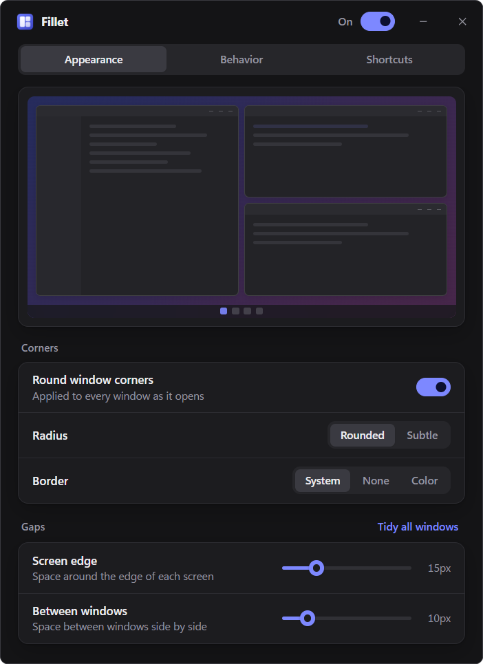

# Fillet: rounded corners and tidy window gaps for Windows 11

Fillet is a small tray app that keeps your windows looking neat. It rounds
every window's corners and lays windows out with even gaps between them and
around the edge of each screen. It's built to run all the time: the part that
stays running is a few MB of native code that sleeps until Windows tells it
something changed.



## Download

Grab the Windows installer from the
[latest release](https://github.com/thekdence/fillet-rounded-corners/releases/latest)
and run it. Fillet opens its settings, then lives in the tray. To keep it
running all the time, turn on **Start with Windows** under Behavior.
Requires Windows 11.

## Features

- **Rounded corners everywhere.** Every window gets Windows 11's rounded
  corners (or the subtler small ones) as it opens, including the ones that
  normally stay square.
- **Trims apps that won't round.** Some apps ignore Windows' corner setting.
  Fillet clips those to a rounded shape instead, with a radius you choose.
  Chrome is on the list by default.
- **Window borders.** Keep the system border, hide it, or pick a color.
- **Active window** (optional). Give the window you're using a border in
  your accent color or any color, and dim everything behind it, taskbar
  included, by as much as you like. Focus changes fade rather than snap,
  and with several screens you can keep the front window on each one
  bright.
- **Gaps.** Set the space around each screen's edge and between windows.
  Windows already in a layout move to the new spacing as you drag the slider.
- **Shortcuts** (all can be changed):

  | Shortcut | Action |
  | --- | --- |
  | Win+Alt+Enter | Tidy the active window into the layout it's closest to |
  | Win+Alt+A | Tidy every window on the active screen |
  | Win+Alt+Shift+A | Tidy every window on every screen |
  | Win+Alt+← / → | Left or right half. Press again for two thirds, then one third |
  | Win+Alt+↑ | Fill the screen, keeping the gaps |
  | Win+Alt+↓ | Centered window |
  | Win+Alt+C | Re-apply corners to every window |

- **Automatic tidying** (optional). Snap a window with Windows' own snapping
  (drag to an edge, Win+Arrow, snap layouts) and Fillet adds the gaps.
  Dragging a window to the top of the screen gives a full screen with gaps.
- **Keep maximized windows round** (optional). Maximize becomes full screen
  with gaps, so the corners stay round.
- **Leave apps alone.** Fillet never touches apps on this list.
- **Clean exit.** Pausing or quitting Fillet puts every window back the way
  Windows draws it.

## How light is it?

The tray part is native Rust with no polling: it listens for window events
and shortcuts and sleeps in between. The settings window is a web view that's
created when you open it and destroyed when you close it, so it only costs
real memory while you're using it. Measured on Windows 11: about 2 MB of
private memory at startup, around 4 MB once you've opened and closed
settings (Windows keeps the web view's libraries loaded), and no CPU while
idle.

## Shortcuts Windows already uses

Windows 11 claims Win+Alt+Arrow for its own snapping. When a shortcut you've
picked is already registered by Windows or another app, Fillet catches it
first with a low-level keyboard hook, the same way AutoHotkey does. The hook
runs on its own thread, so it never slows your typing, and it only exists
while a shortcut needs it. The Shortcuts page marks these with "Takes over
from Windows or another app".

## Development

You need [Rust](https://rustup.rs), [Node.js](https://nodejs.org) 20+ and the
[Tauri prerequisites](https://tauri.app/start/prerequisites/).

```bash
npm install
npm run tauri dev
```

`npm run dev` opens just the settings UI in a browser with a fake backend.

Run the tests (layout maths and settings):

```bash
cargo test --manifest-path src-tauri/Cargo.toml
```

Build the installer:

```bash
npm run tauri build
```

## How it works

- `src-tauri/src/engine/` is the always-on part: one thread with WinEvent
  hooks (window shown, focused, moved, restored), global shortcuts, and a
  short debounce so a burst of events is handled once.
  - `win.rs` wraps the Win32 and DWM calls.
  - `keys.rs` is the keyboard-hook fallback for taken shortcuts.
- `src-tauri/src/layout.rs` is the layout maths. It's pure code with unit
  tests.
- `src-tauri/src/lib.rs` is the tray, the settings window and the commands
  the UI calls.
- `src/` is the React settings UI.

Settings live in `%APPDATA%\dev.fillet.app\config.json`.

## License

[MIT](LICENSE)
